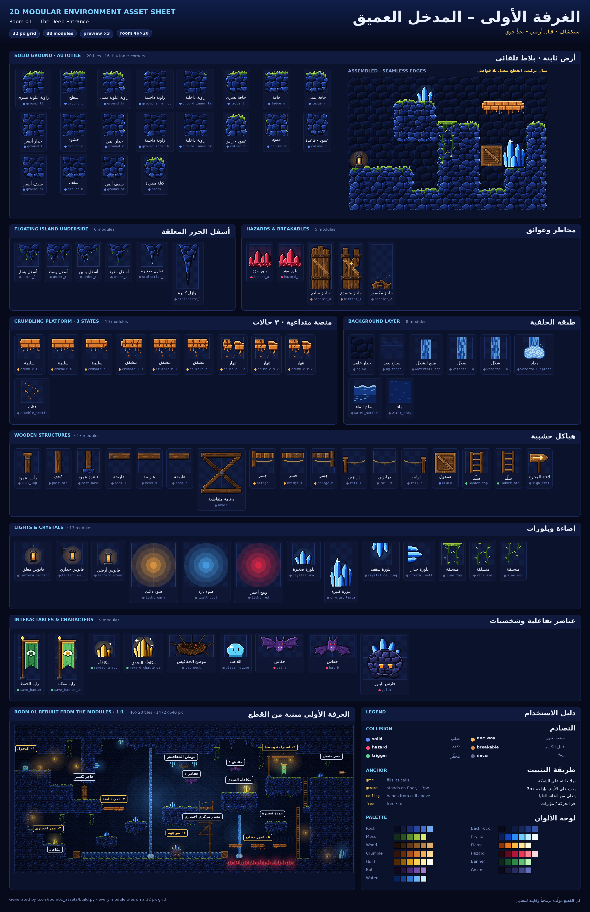
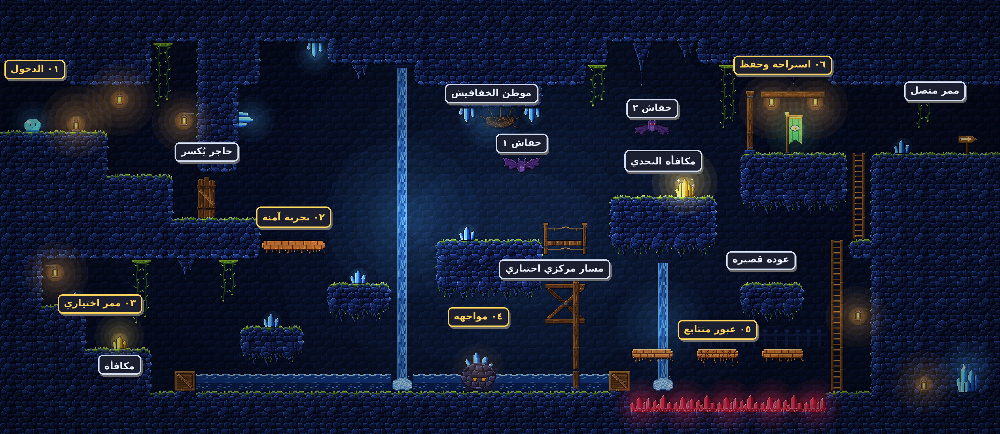

# الغرفة الأولى – المدخل العميق · 2D Modular Environment Asset Sheet



لوحة أصول بيئية معيارية (Modular) للغرفة الأولى، مبنية على شبكة **32×32 بكسل**.
كل قطعة تتصل بجاراتها بلا فواصل، والغرفة كاملة أُعيد بناؤها من هذه القطع فقط.

A modular pixel-art kit for Room 01 on a **32 px grid**. Every piece tiles cleanly,
and the whole room below is rebuilt from these modules only.



## الملفات · Files

| الملف | المحتوى |
|---|---|
| `asset_sheet.png` | لوحة العرض: كل القطع مكبّرة ×3 بأسماء عربية ومعرّفات، مع مثال تركيب ودليل الاستخدام |
| `tileset.png` | أطلس القطع بالحجم الأصلي (1x) جاهز للمحرك |
| `tileset.json` | إحداثيات كل قطعة + نوع التصادم + طريقة التثبيت + الحركات + قواعد البلاط التلقائي |
| `modules/*.png` | كل قطعة كصورة مستقلة (88 قطعة) |
| `room01_preview.png` | الغرفة مبنية من القطع (×2) |
| `room01_annotated.png` | نفس الغرفة مع مسميات المسار (٠١ → ٠٦) |
| `room01_map.json` | شبكة الغرفة وأماكن كل قطعة والإضاءة، لإعادة بنائها داخل المحرك |

## الأقسام · Sections (88 modules)

| القسم | Section | عدد |
|---|---|---|
| أرض ثابتة (بلاط تلقائي) | Solid ground autotile – 16 + 4 inner corners | 20 |
| أسفل الجزر المعلقة ونوازل | Island undersides & stalactites | 6 |
| منصة متداعية (سليمة / تتشقق / تنهار) | Crumbling platform, 3 states + debris | 10 |
| مخاطر وعوائق (بلور مؤذٍ، حاجز يُكسر) | Red-crystal hazard, breakable barrier (3 states) | 5 |
| هياكل خشبية | Posts, beams, X-brace, bridge, rails, crate, ladder, sign | 17 |
| إضاءة وبلورات ومتسلقات | Lanterns, light pools, blue crystals, vines | 13 |
| عناصر تفاعلية وشخصيات | Save banner, rewards, bat nest, player, bat (2 frames), golem | 9 |
| طبقة الخلفية | Back wall, far fence, waterfall (2 frames), water | 8 |

## الاستخدام في المحرك · Using it in an engine

- **البلاط التلقائي:** اختر قطعة الأرض حسب الجيران الأربعة الصلبة (شمال، شرق، جنوب، غرب).
  إذا كانت الأربعة صلبة وكان أحد الأقطار فارغاً، استخدم الزاوية الداخلية المقابلة.
  القواعد كاملة في `tileset.json → autotile`.
  *Autotile: pick by the solid n/e/s/w neighbours; with all four solid, an empty diagonal selects the inner corner.*
- **سطح الأرض منحوت 3px للأسفل:** القطع ذات `anchor: ground` تُرسم أخفض بـ `offset_y = 3` لتجلس على السطح.
  *Ground-anchored props draw 3 px lower so they sit on the carved floor.*
- **التصادم:** `solid` صلب · `one_way` منصة عبور من الأسفل · `hazard` ضرر · `breakable` يُكسر · `trigger` مُحفِّز · `none` زينة.
- **الحركات:** `bat_fly`، `waterfall`، `crumble`، `barrier_break` معرّفة في `tileset.json → animations`.
- **الإضاءة:** `light_warm / light_cool / light_red` بقع ضوء تُستخدم بمزج إضافي (Additive).
- **أسفل الجزر (`under_*`)** زخرفة بلا تصادم تُعلَّق تحت أي جزيرة عائمة.

## إعادة التوليد والتعديل · Regenerate / tweak

كل القطع مرسومة برمجياً، فتعديل الألوان أو الأشكال يتم من الكود ثم إعادة البناء:

```bash
pip install pillow numpy
python3 tools/room01_assets/build.py            # يكتب إلى assets/room01_deep_entrance/
```

- الألوان: `tools/room01_assets/palette.py`
- الأرض والبلاط التلقائي: `terrain.py` · باقي القطع: `props.py`
- تخطيط الغرفة (الشبكة والزينة والإضاءة والمسميات): `room.py`
- قائمة القطع وأسماؤها العربية: `catalog.py` · لوحة العرض: `sheet.py`
